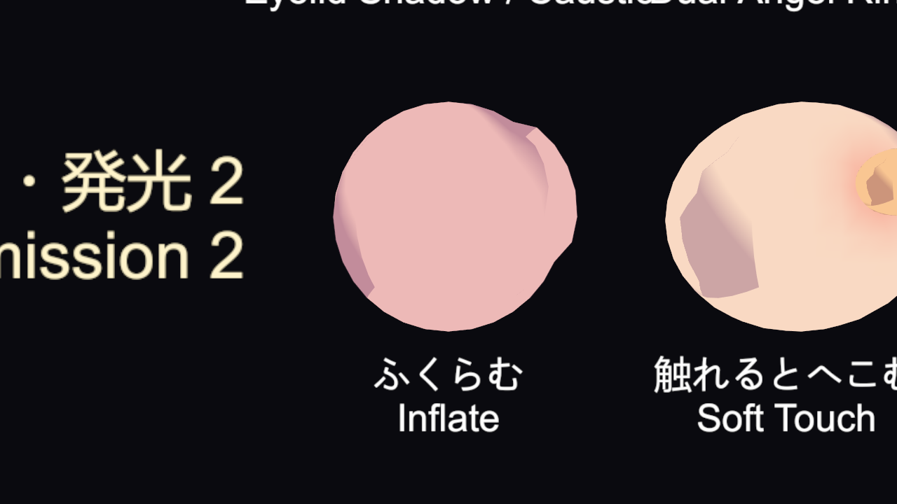
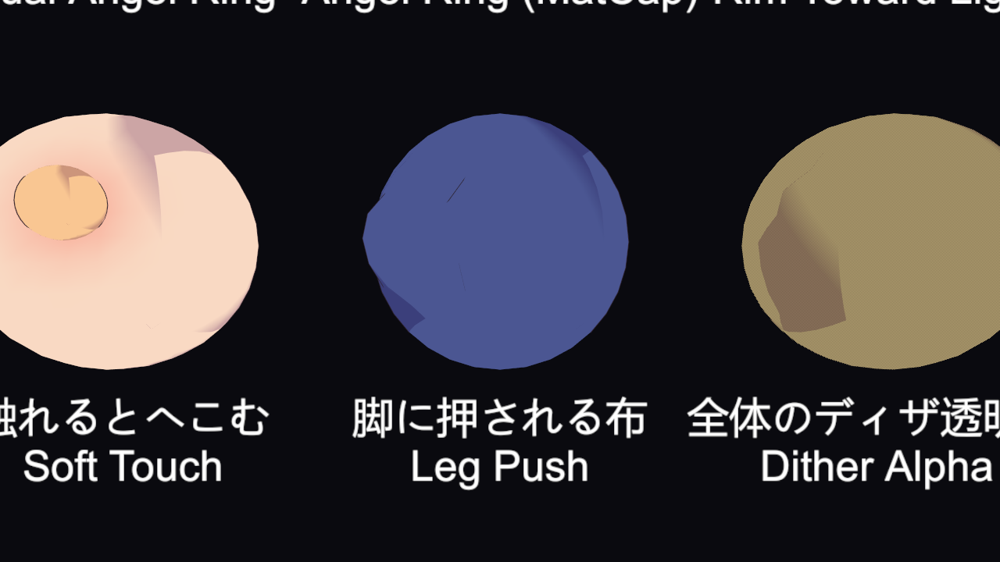
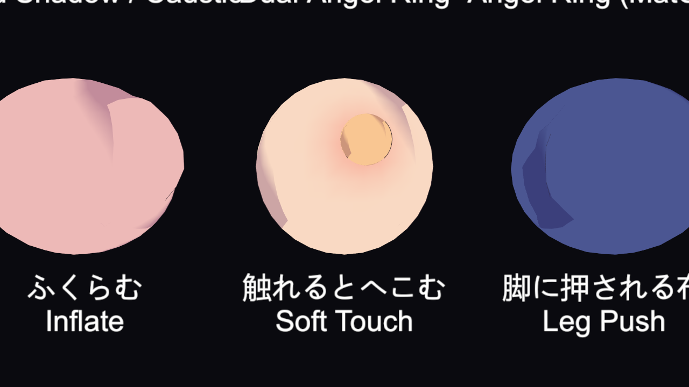
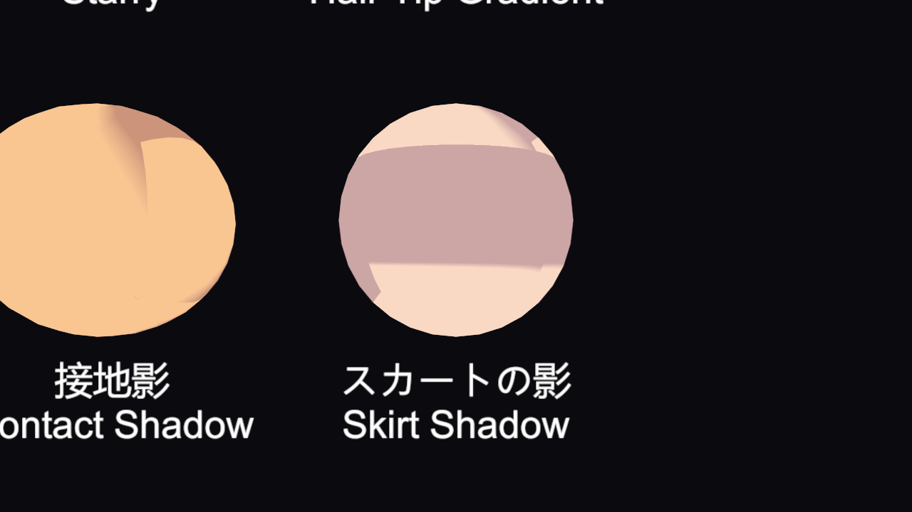

# Shader: Shape Changes and Script Inputs

[Documentation index](README.md)

Features that change the shape in the vertex stage, and features driven by values from your scripts (added in 1.0.2). Shape changes are applied the same way in the shadow, depth, outline, and motion vector passes, so shadows and lines stay aligned with the body.

- [Inflate](#inflate)
- [Leg Push](#leg-push)
- [Soft Touch](#soft-touch)
- [Skirt Shadow](#skirt-shadow)
- [Back Light](#back-light)
- [Flatten](#flatten)
- [Sample Component (Galaxy Toon Sample Contact)](#sample-component-galaxy-toon-sample-contact)

---

## Inflate



Pushes vertices along the normal for a rounded bulge. In the **Inflate / Cloth Pushed by Legs** section.

| Property | Description |
|---|---|
| Inflate | 0 = off, 1 = on |
| Inflate Amount | Push distance (m). Negative values dent inward |
| Inflate Mask | Inflates by the R strength (white = everywhere) |
| Inflate Center | xyz = center (world), w = radius. Inflates only inside the sphere. w = 0 uses the mask only |
| Inflate Round | 1 = smooth bulge, 0 = flat |

## Leg Push



Skirt and hem vertices that end up inside a leg (capsule) are pushed out to the leg surface, so legs no longer poke through the cloth. Set **Leg Push** on the material to 1 and pass the leg positions from a script as global values.

| Global | Contents |
|---|---|
| `_GalaxyLegStart0` / `_GalaxyLegEnd0` | First leg. Start xyz = root, w = radius (m); End xyz = tip. Radius 0 = unused |
| `_GalaxyLegStart1` / `_GalaxyLegEnd1` | Second leg |

```csharp
// Every frame, from the thigh bones (example)
Shader.SetGlobalVector("_GalaxyLegStart0", new Vector4(hip.x, hip.y, hip.z, 0.08f));
Shader.SetGlobalVector("_GalaxyLegEnd0", knee);
```

## Soft Touch



When a contact (capsule) enters the skin, it dents in the vertex stage. The surroundings sink smoothly and the outside bulges a little (volume preservation). A blush where it is pressed and a shadow from approaching objects appear as well.

| Property | Description |
|---|---|
| Soft Touch | 0 = off, 1 = on |
| Softness | How easily it dents (0–1) |
| Soft Mask | R = softness, G = flesh thickness (white = thick; thin areas dent less), B = flatness (white = flat; on round parts the dent follows the surface) |
| Soft Depth | Maximum dent depth (m) |
| Soft Spread | How far the surroundings sink, as a multiple of the contact radius |
| Soft Bulge | How much the outside bulges |
| Soft Blush | Redness where pressed. A is the strength |
| Soft Shadow | How much the surface darkens as an object approaches |

Pass contacts per renderer through a **MaterialPropertyBlock** (up to 32).

| Value | Contents |
|---|---|
| `_SoftContactA` (Vector4 array, 32) | xyz = capsule end A, w = radius (m) |
| `_SoftContactB` (Vector4 array, 32) | xyz = capsule end B, w = strength (0 = ignored) |
| `_SoftContactCount` (float) | Number of contacts in use |

```csharp
var block = new MaterialPropertyBlock();
renderer.GetPropertyBlock(block);
contactA[0] = new Vector4(fingerTip.x, fingerTip.y, fingerTip.z, 0.01f); // end A and radius
contactB[0] = new Vector4(fingerBase.x, fingerBase.y, fingerBase.z, 1f); // end B and strength
block.SetVectorArray("_SoftContactA", contactA); // always pass 32 elements (the length is fixed by the first call)
block.SetVectorArray("_SoftContactB", contactB);
block.SetFloat("_SoftContactCount", 1);
renderer.SetPropertyBlock(block);
```

> **Galaxy Toon Effects** keeps these values when it rebuilds the block, so both can be used on the same renderer.

## Skirt Shadow



Shades the inside of a skirt (waist to hem) and a band of leg just below the hem. Raise **Skirt Shadow Receive** in the body material's Shadow section and pass the skirt shape from a script as global values.

| Global | Contents |
|---|---|
| `_GalaxySkirtShadow` | x = hem height, y = width of the band below the hem, z = strength (0 = off), w = radius (m) |
| `_GalaxySkirtShadowCenter` | x = center X, y = center Z, z = waist height (all world space) |

## Back Light

Brightens only the silhouette on the side the light comes from, as a thin crisp band (the anime back-light edge). Works even on materials without rim settings.

| Global | Contents |
|---|---|
| `_GalaxyBackLightDir` | xyz = direction the light comes from (world) |
| `_GalaxyBackLightColor` | rgb = color, a = strength (0 = off) |

> These are globals, so they affect **every** GalaxyToon material.

## Flatten

Squashes up to three regions (face, chest, body, ...) along the view direction so they look flat. Set the values per camera from a script on the material (or a MaterialPropertyBlock). They are not shown in the Inspector.

| Value | Contents |
|---|---|
| `_Flatten0` – `_Flatten2` | xyz = region center (world), w = radius (m) |
| `_FlattenAmount` | xyz = strength of regions 1–3 (0–1) |
| `_FlattenCamera` | xyz = camera position (perspective) or direction (orthographic); w = 0 off, 1 perspective, 2 orthographic |

## Sample Component (Galaxy Toon Sample Contact)

In the sample scene, `Runtime/GalaxyToonSampleContact.cs` feeds the Soft Touch, Leg Push, and Skirt Shadow samples. Read its code as an example of how to do it in your own game.

| Property | Description |
|---|---|
| Kind | SoftTouch (dents the target's skin) / LegPush (leg capsule) / SkirtShadow (skirt shadow centered here) |
| Target | The renderer to dent (SoftTouch) |
| Radius | Capsule radius (m). For SkirtShadow, the radius of the shaded area |
| Half Length | Distance from the capsule center to each end (m, along this object's up) |
