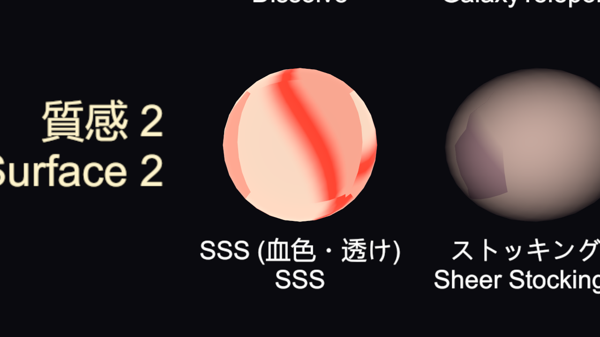
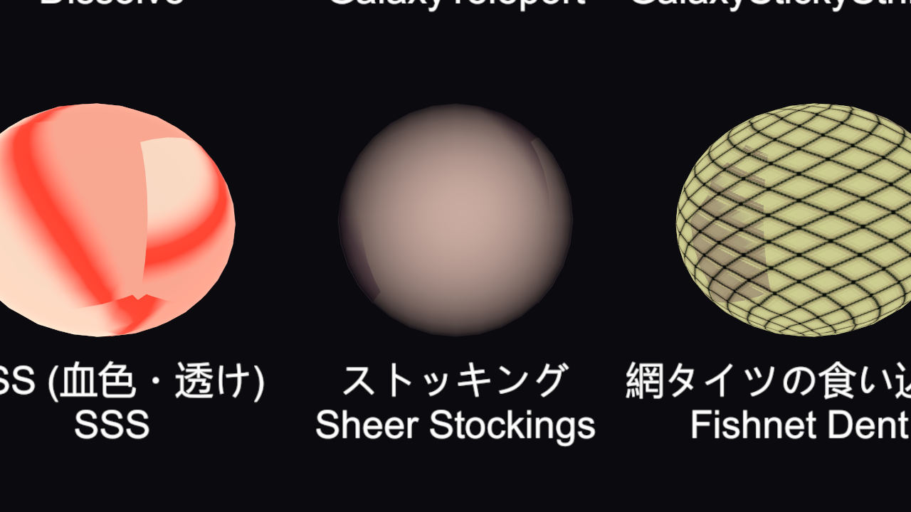
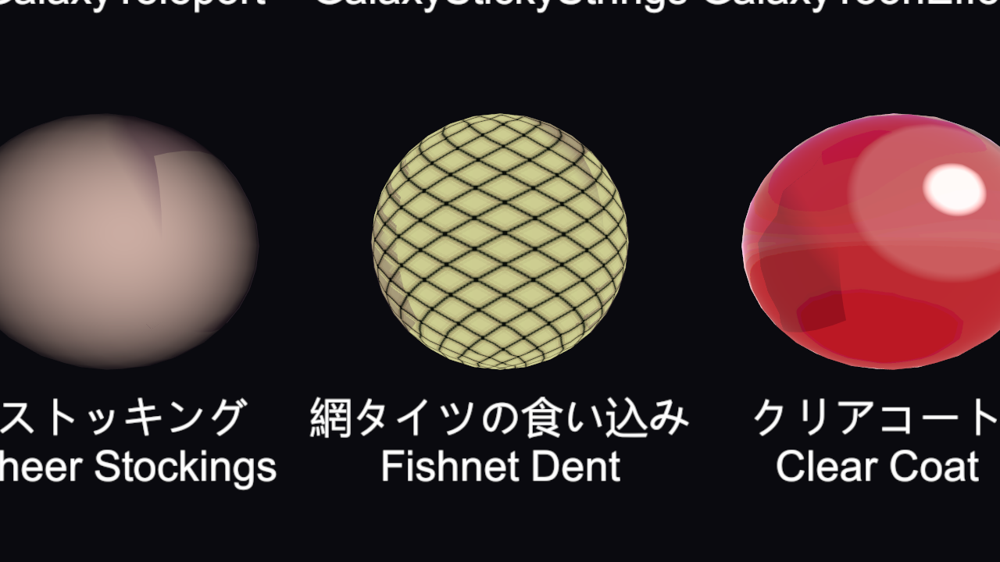
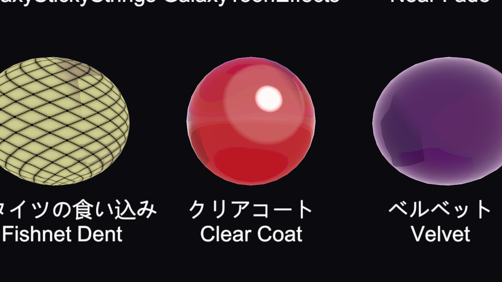
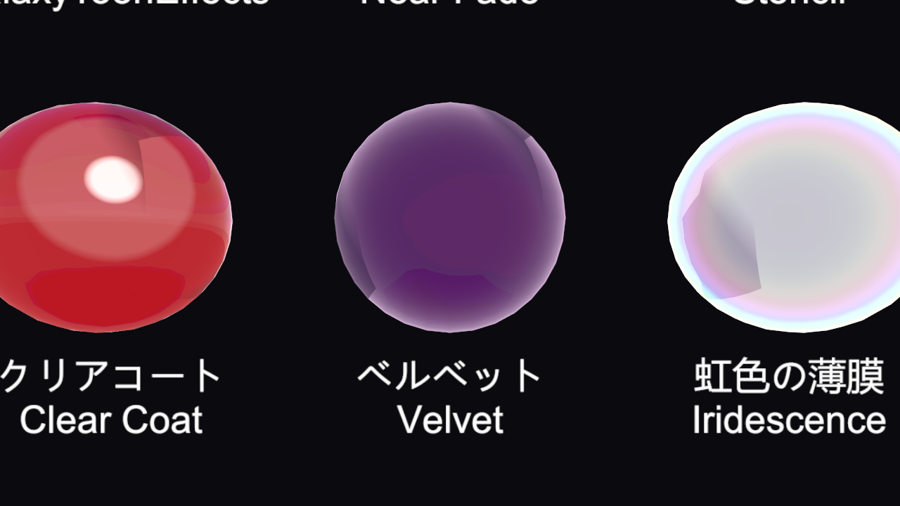

# Shader: Skin and Cloth

[Documentation index](README.md)

The `GalaxyShader/Toon` sections for skin and cloth surfaces (added in 1.0.2).

- [SSS (Skin Subsurface Scattering)](#sss-skin-subsurface-scattering)
- [Stockings / Sheer Fabric](#stockings--sheer-fabric)
- [Fishnet Dent](#fishnet-dent)
- [Clear Coat / Velvet](#clear-coat--velvet)

---

## SSS (Skin Subsurface Scattering)

Adds light scattering under the skin in a way that fits toon shading. Turn on **Use SSS** and set the color's A above 0. The **Skin SSS (Warm Bleed & Translucency)** preset sets everything at once.

| Property | Description |
|---|---|
| Use SSS | On / off |
| SSS Color | The warm color at the shadow border and in back light. A is the strength |
| SSS Edge Width | Width of the warm band at the light/shadow border |
| SSS Shadow Bleed | How much of the warm color stays inside the shadow |
| SSS Translucency | How strongly ears, nose tips, and fingertips glow red when lit from behind or at an angle |
| SSS Distortion | How much the transmitted light is bent by the normal |
| SSS Power | Higher values limit the glow to the area right behind the light |
| SSS Front Scatter | 0 = only in back light. Higher values also make the silhouette and border glow in front or side light (limit it to thin areas with the thickness map first) |
| Thickness / SSS Mask | Only white (thin) areas in R glow. **Tools > GalaxyToon > 厚みマップを作る** (Create Thickness Map) builds it from the mesh |

## Stockings / Sheer Fabric

Stockings, tights, and sheer cloth: skin shows through where the surface faces the camera, and the fiber color gets denser toward the edges. The base color (main color / main texture) is the fiber color.

| Property | Description |
|---|---|
| Use Sheer | On / off |
| Sheer Amount | How much skin shows through when facing the camera |
| Sheer Skin Color | The skin color that shows through |
| Sheer Power | The denier feel. Lower values show skin up to the edge; higher values darken the edges |
| Sheer Sheen | The fine gloss typical of stockings |
| Sheer Mask | Only white areas in R are sheer (to exclude areas other than the legs) |

## Fishnet Dent

The net drawn in the base texture presses into the skin, and the skin between the strands bulges. It uses both normals and color, so it also shows with anime shading.

| Property | Description |
|---|---|
| Use Net Dent | On / off |
| Net Source | 0 = dark lines in the base texture are the net, 1 = the texture alpha is the net |
| Net Threshold | Areas darker than this are treated as net |
| Net Dent Mask | Only white areas in R are affected (whole surface if empty) |
| Dent Width | Width of the dent along the strands (texels) |
| Dent Strength | Depth of the dent (normal tilt) |
| Dent Shadow / Dent Shadow Color | Darkness and color of the shade where the net presses in |
| Net Cell Highlight | How bright the bulging skin between the strands looks |

## Clear Coat / Velvet

These are in the **Metallic / Smoothness / Reflection** section.

|  |  |
|---|---|
| Clear Coat | Velvet |

| Property | Description |
|---|---|
| Clear Coat | Strength of a clear varnish layer over enamel or paint. Adds a sharp second reflection on top while keeping the base gloss |
| Clear Coat Smoothness | Sharpness of the varnish reflection |
| Velvet Color | Color of the soft whitening toward the edges of brushed fabric. A is the strength |
| Velvet Power | Lower values cover the whole surface; higher values only the edges |

The **Clear Coat (Dual Gloss)** and **Velvet (Soft Fuzz)** presets set these too.
