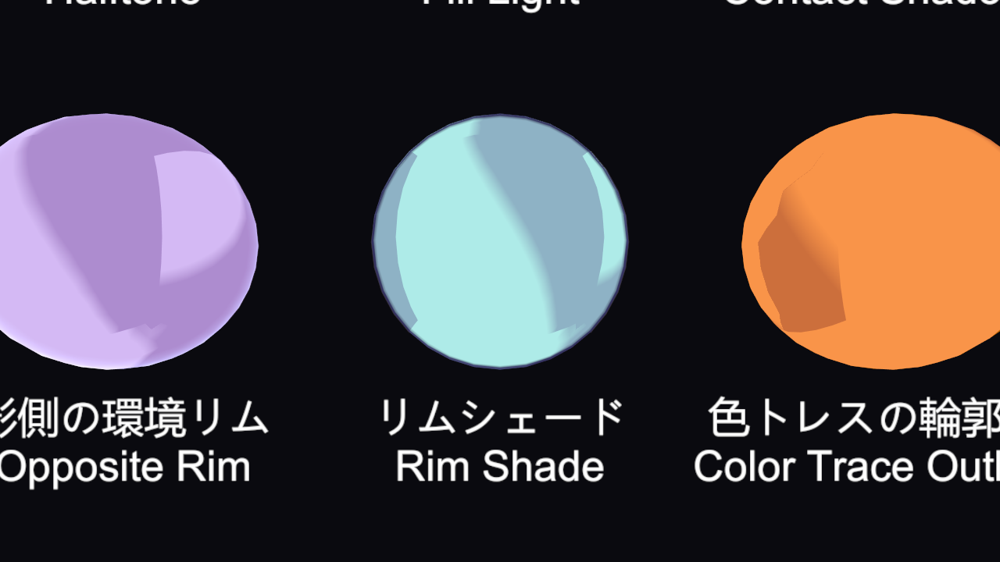
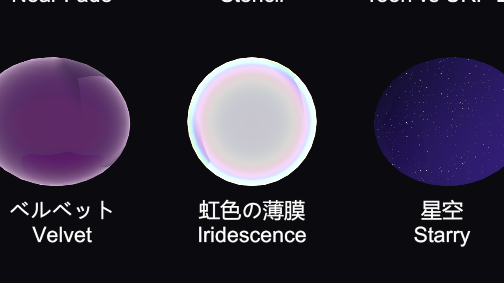
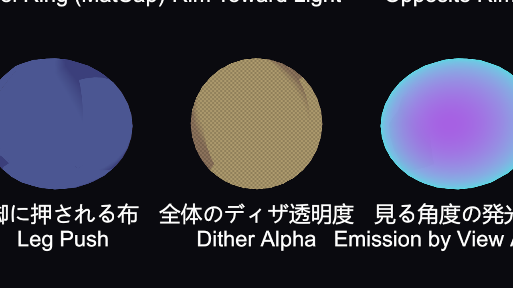
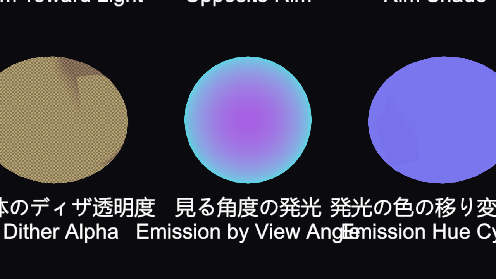
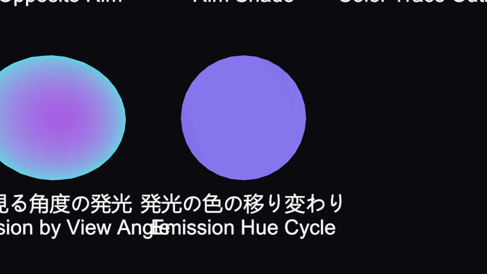
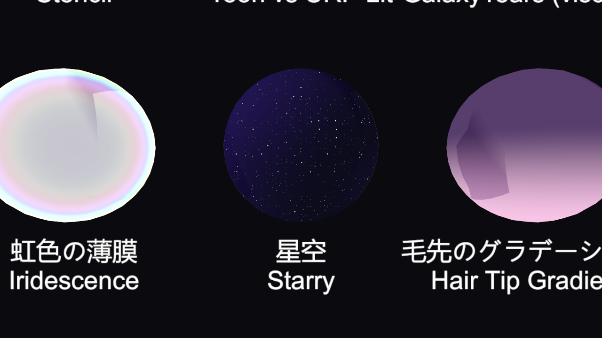

# Shader: Toon Plus

[Documentation index](README.md)

The Inspector section **Toon Plus (Light / Shadow / Rim / MatCap / Perspective)** (added in 1.0.2). Every property defaults to a value that does nothing; only the ones you change take effect.

- [Light](#light)
- [Shadow](#shadow)
- [Rim, MatCap, Iridescence](#rim-matcap-iridescence)
- [Depth and Perspective](#depth-and-perspective)
- [Hair, Highlights, Emission](#hair-highlights-emission)
- [Vertex Colors](#vertex-colors)
- [Outline](#outline)
- [Contact Shadow / Body Self-Shadow](#contact-shadow--body-self-shadow)
- [Starry Sky](#starry-sky)
- [Nose Line](#nose-line)
- [Packed Mask](#packed-mask)
- [Audio / Volume](#audio--volume)

---

## Light

| Property | Description |
|---|---|
| Light Normalize | Scales the light color so its brightest channel is 1, keeping only the hue. Dark-colored lights no longer darken the paint |
| Light Soft Limit | Brightness above 1 is reduced gradually instead of clipping |
| Ambient Head Split | Reads the ambient light (SH) only toward the front and back of the head, so the shading direction stays stable when the head turns. **Galaxy Toon Face** supplies the head direction |
| Additional Light Ignore Normal | Point and spot lights brighten by distance only, ignoring the surface direction |
| Additional Light Border | The lit/unlit border for additional lights. Negative = same as the Shadow 1 border |
| Additional Light Max / Mono | Brightness cap and grayscale for additional lights |

## Shadow

| Property | Description |
|---|---|
| Shadow Ambient Tint | Applies the ambient (SH) hue only to shadowed areas. Shadows take on the sky color at sunset or under a blue sky |
| Receive Shadow Offset | Shifts where the cast shadow is read, toward the light (cm). Reduces self-shadow artifacts on the face and body |
| Ramp Day / Night | Treats the top half of the shadow ramp as day and the bottom half as night, mixed by **Night Ramp Amount**. The global `_GalaxyNight` (**Night** on **Galaxy Toon Light**) is added too |

## Rim, MatCap, Iridescence

| Property | Description |
|---|---|
| Rim Shade | Darkens and tints the inside of the silhouette by multiplication (separate from the additive rim). A is the strength |
| Rim Shade Power / Border / Blur | The shape of the rim shade |
| Depth Rim Softness | Reads the depth rim at three offsets for a smooth edge. 0 = the previous hard edge |
| MatCap Perspective | Keeps the MatCap undistorted near the screen edges |
| MatCap No Roll | The MatCap does not rotate when the camera tilts |
| MatCap Mask | MatCap only where R is white |
| Iridescence Strength / Scale / Shift | A thin film whose hue rotates with the view angle (soap bubbles, oil, beetle shells) |

## Depth and Perspective

| Property | Description |
|---|---|
| Z Offset | Moves only the depth toward the camera (cm), without moving the image. Use it to draw brows and eye lines in front of the hair |
| Z Offset Mask | Only white areas in R are shifted |
| Perspective Removal | Projects using the depth of the head center, so the face does not distort in close wide-angle shots. **Galaxy Toon Face** supplies the center (the same center for the whole character, so the face and hair stay aligned) |
| Dither Alpha | 1 = opaque. Lower values cut out a dither pattern. The shadow, depth, and outline passes use the same pattern, so it works for fade-in/out effects and characters behind obstacles |

## Hair, Highlights, Emission

| Property | Description |
|---|---|
| Aniso Center Shape | Makes the angel ring round and short in front and long and thin at the edges |
| Specular AA | Blurs the highlight edge where it changes fast on screen (distant or fine detail) to stop flickering |
| Texture Line Keep | Keeps lines drawn in the texture from fading out at a distance due to mipmaps |
| Emission Hue Speed | Rotates the emission hue over time (rotations per second) |
| Emission View Color | A different emission color toward the edges. A is the strength |

|  |  |
|---|---|
| Emission by View Angle | Emission Hue Cycle |

## Vertex Colors

You can give the mesh vertex colors a meaning.

| Property | Vertex color | Description |
|---|---|---|
| Vertex Color Shadow | R | Darker R means more shadow |
| Vertex Color Bias | G | Gray (0.5) = unchanged. Brighter means less shadow |
| Outline Vertex Depth | B | Pushes the outline back to hide inner lines (cm) |
| Outline Vertex Alpha | A | Multiplies the outline width |

## Outline

| Property | Description |
|---|---|
| Outline Light Width | Makes the outline thicker on the lit side |
| Outline Fade Start / End | Thins and then removes the outline with distance (m), so distant characters' lines don't clump. Not used when start is greater than end |

## Contact Shadow / Body Self-Shadow

| Property | Description |
|---|---|
| Contact Shadow | Marches the camera depth texture toward the light and adds thin shadows at contact points such as fingers and collars (on / off) |
| Contact Shadow Strength / Length | Darkness and march length (cm) |
| Self Shadow Strength / Length / Thickness | A longer version of the same march for shadows under the chin and from the arms onto the body (needs Contact Shadow on) |

> Needs the camera depth texture. Turn on **Depth Texture** in the URP Asset.

## Starry Sky

| Property | Description |
|---|---|
| Starry Strength | Strength of screen-anchored stars and nebula, only inside the mask |
| Starry Mask | Only where R is white |
| Star Color / Nebula Color | Star color and nebula color (A is the strength) |
| Starry Scale / Parallax | Number of stars and how much they shift with the view angle |

## Nose Line

Draws a line along the nose bridge only when the face is seen in profile.

| Property | Description |
|---|---|
| Nose Line Mask | The line appears where R is white. Paint it to match the face texture |
| Nose Line Color | Line color. A is the strength (0 = off) |
| Nose Line Side | How far the face must turn before the line appears |

## Packed Mask

Several masks packed into the RGBA channels of one texture.

| Property | Description |
|---|---|
| Use Packed Mask | On / off |
| Packed Mask (texture) | R = highlight strength, G = shadow threshold, B = highlight mask, A = material ID (0–7) |
| Packed Mask G Bias | How strongly G shifts the shadow |
| Material ID Colors | A color table: 4 columns (highlight, rim, outline, glow color) × 8 rows (material ID) |

## Audio / Volume

| Property | Description |
|---|---|
| Audio Band | Which band to follow: low, mid, high, or all |
| Audio Emission / Rim / Outline | How much the sound level boosts emission, rim, and outline width |
| Volume Receive | Whether the "Galaxy Toon" Volume affects this material. Turn it off for eyes and other parts you want to exclude |

**Galaxy Audio React** supplies the sound level and **Galaxy Toon Volume Feature** the Volume values. See [Screen Effects, Audio, Volume](rendering.md).
