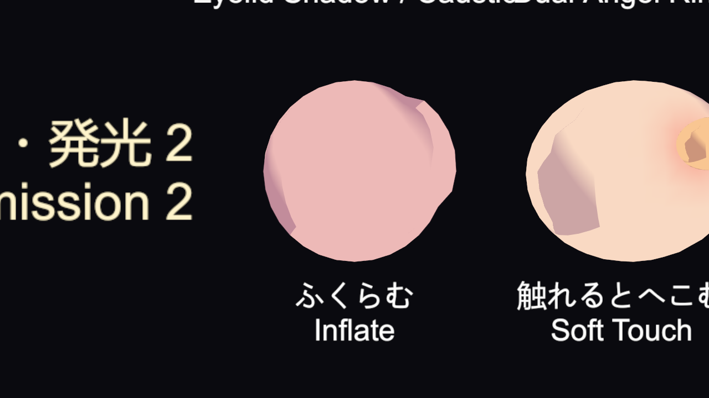
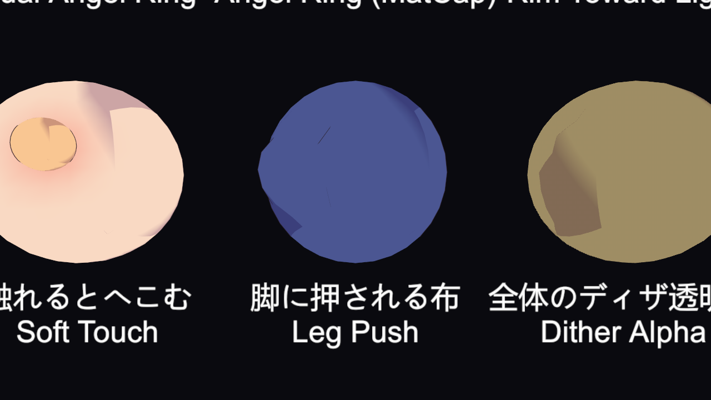
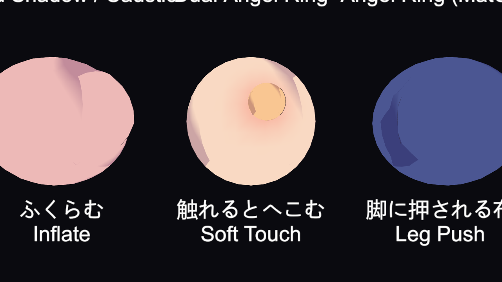
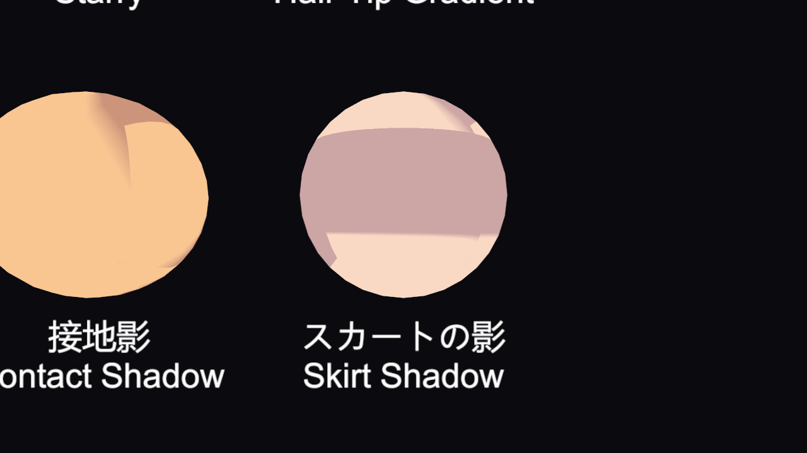

# シェーダー: 形を変える・スクリプトから渡す値

[ドキュメント目次](README.md)

頂点の段階で形を変える機能と、スクリプトから値を渡して使う機能の説明です(1.0.2 で追加)。形の変化は、影・深度・輪郭線・動きのベクトルのパスでも同じように掛かるので、影や線が本体とずれません。

- [ふくらむ](#ふくらむ)
- [脚に押される布](#脚に押される布)
- [触れるとへこむ](#触れるとへこむ)
- [スカートの影](#スカートの影)
- [後ろからの光](#後ろからの光)
- [平面化](#平面化)
- [サンプルの部品(Galaxy Toon Sample Contact)](#サンプルの部品galaxy-toon-sample-contact)

---

## ふくらむ



頂点を法線の向きへ押し出して、丸くふくらませます。見出し **ふくらむ・脚に押される布** にあります。

| 項目 | 説明 |
|---|---|
| ふくらむ | 0 = オフ、1 = オン |
| ふくらむ量 | 押し出す量(m)。負の値でへこみます |
| ふくらむ所のマスク | R の強さでふくらませます(白で全部) |
| ふくらむ球 | xyz = 中心(ワールド座標)、w = 半径。球の中だけをふくらませます。w = 0 ならマスクだけで決まります |
| 球の丸さ | 1 でなだらか、0 で平らなふくらみ |

## 脚に押される布



スカートや裾の頂点が、脚(カプセル)の中に入ったら、脚の外側まで押し出します。脚が布を突き抜けなくなります。マテリアルの **脚に押される布** を 1 にし、脚の位置をスクリプトからグローバル値で渡します。

| グローバル値 | 内容 |
|---|---|
| `_GalaxyLegStart0` / `_GalaxyLegEnd0` | 1 本目の脚。Start の xyz = 付け根、w = 太さ(m)、End の xyz = 先。太さ 0 なら使いません |
| `_GalaxyLegStart1` / `_GalaxyLegEnd1` | 2 本目の脚 |

```csharp
// 毎フレーム、太もものボーンからカプセルを入れる(例)
Shader.SetGlobalVector("_GalaxyLegStart0", new Vector4(hip.x, hip.y, hip.z, 0.08f));
Shader.SetGlobalVector("_GalaxyLegEnd0", knee);
```

## 触れるとへこむ



触れるもの(カプセル)が肌に入ると、頂点の段階でへこみます。まわりはなめらかに沈み、外側は少し盛り上がります(体積を保つ)。押した所の血色と、近づくものの影も出ます。

| 項目 | 説明 |
|---|---|
| 触れるとへこむ | 0 = オフ、1 = オン |
| やわらかさ | へこみやすさ(0〜1) |
| やわらかさのマスク | R = やわらかさ、G = 肉の厚み(白=厚い。薄い所は浅くへこむ)、B = 平らさ(白=平ら。丸い所ほど、へこみが面に沿う) |
| いちばん深いへこみ | へこみの深さの上限(m) |
| まわりの沈む幅 | 触れるものの太さの何倍まで沈むか |
| まわりの盛り上がり | 外側が盛り上がる量 |
| 押した所の血色 | 押した所に乗る赤み。A が強さです |
| 近づくものの影 | 面の前にあるものが近づくほど、やわらかく暗くなる量 |

触れるものは、Renderer ごとの **MaterialPropertyBlock** で渡します(最大 32 個)。

| 値 | 内容 |
|---|---|
| `_SoftContactA`(Vector4 の配列、32 個) | xyz = カプセルの端 A、w = 太さ(m) |
| `_SoftContactB`(Vector4 の配列、32 個) | xyz = カプセルの端 B、w = 押す強さ(0 で無視) |
| `_SoftContactCount`(float) | 使う個数 |

```csharp
var block = new MaterialPropertyBlock();
renderer.GetPropertyBlock(block);
contactA[0] = new Vector4(fingerTip.x, fingerTip.y, fingerTip.z, 0.01f); // 端 A と太さ
contactB[0] = new Vector4(fingerBase.x, fingerBase.y, fingerBase.z, 1f); // 端 B と強さ
block.SetVectorArray("_SoftContactA", contactA); // 配列は常に 32 個で渡す(最初の長さで固定されるため)
block.SetVectorArray("_SoftContactB", contactB);
block.SetFloat("_SoftContactCount", 1);
renderer.SetPropertyBlock(block);
```

> **Galaxy Toon Effects** は、ブロックを作り直すときにこの値を消さずに残します。両方を同じ Renderer に使えます。

## スカートの影



スカートの中(腰〜裾)と、裾のすぐ下の帯の脚を影にします。体のマテリアルの「影」にある **スカートの影を受ける** を上げ、スカートの形をスクリプトからグローバル値で渡します。

| グローバル値 | 内容 |
|---|---|
| `_GalaxySkirtShadow` | x = 裾の高さ、y = 裾から下の帯の幅、z = 強さ(0 で使わない)、w = 半径(m) |
| `_GalaxySkirtShadowCenter` | x = 中心の X、y = 中心の Z、z = 腰の高さ(すべてワールド座標) |

## 後ろからの光

光の来る側の輪郭だけを、細くくっきりした帯で明るくします(アニメの逆光の縁)。リムの設定が無いマテリアルにも効きます。

| グローバル値 | 内容 |
|---|---|
| `_GalaxyBackLightDir` | xyz = 光の来る向き(ワールド) |
| `_GalaxyBackLightColor` | rgb = 色、a = 強さ(0 で何もしない) |

> グローバル値なので、GalaxyToon を使う**全マテリアル**に効きます。

## 平面化

最大 3 か所の範囲(顔・胸・体など)を、カメラの向きに押しつぶして平らに見せます。値はマテリアル(または MaterialPropertyBlock)に、カメラごとにスクリプトから入れます。Inspector には出ません。

| 値 | 内容 |
|---|---|
| `_Flatten0` 〜 `_Flatten2` | xyz = 範囲の中心(ワールド)、w = 半径(m) |
| `_FlattenAmount` | xyz = 範囲 1〜3 の強さ(0〜1) |
| `_FlattenCamera` | xyz = カメラの位置(透視)か向き(平行)、w = 0 で使わない・1 で透視・2 で平行 |

## サンプルの部品(Galaxy Toon Sample Contact)

サンプルシーンの「触れるとへこむ」「脚に押される布」「スカートの影」は、`Runtime/GalaxyToonSampleContact.cs` が値を入れています。自分のゲームで使うときの書き方の見本として、コードを読んでください。

| 項目 | 説明 |
|---|---|
| Kind | SoftTouch(target の肌をへこませる)/ LegPush(脚のカプセル)/ SkirtShadow(この位置を中心にスカートの影) |
| Target | へこませる Renderer(SoftTouch のとき) |
| Radius | カプセルの太さ(m)。SkirtShadow では影の範囲の半径 |
| Half Length | カプセルの中心から両端までの長さ(m、この物の上向き) |
