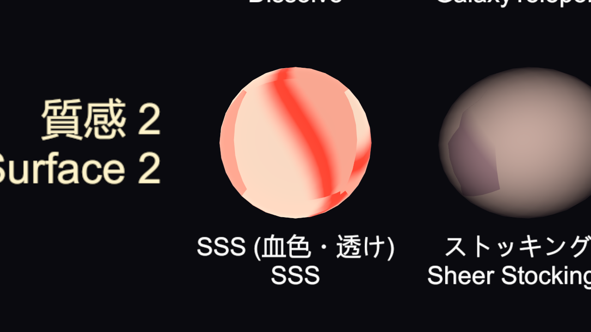
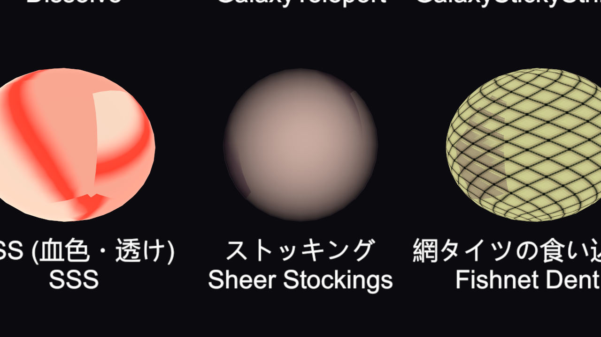
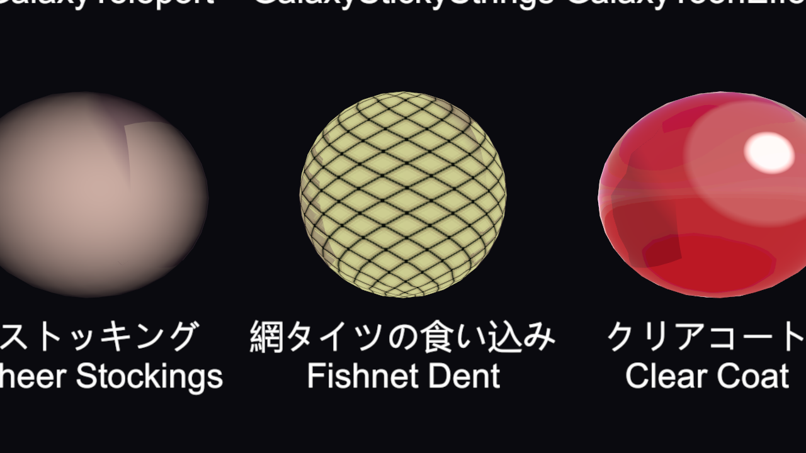
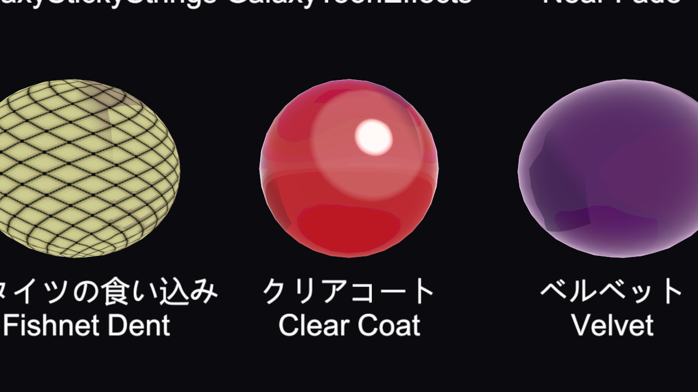
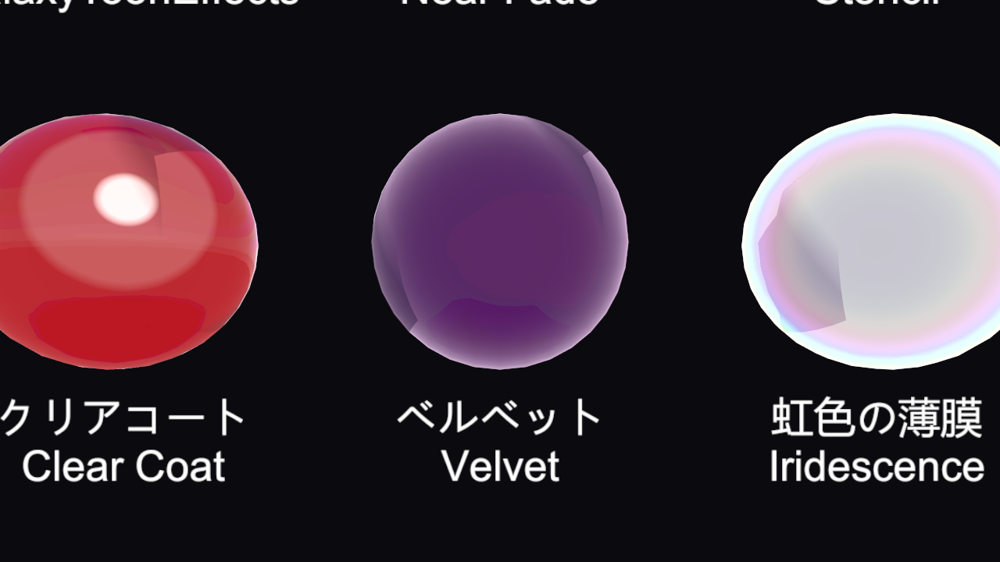

# シェーダー: 肌・布の質感

[ドキュメント目次](README.md)

`GalaxyShader/Toon` の、肌と布の質感に関する見出しの説明です(1.0.2 で追加)。

- [SSS(肌・薄肉の血色と透け)](#sss肌薄肉の血色と透け)
- [ストッキング・薄布の透け](#ストッキング薄布の透け)
- [網タイツの食い込み](#網タイツの食い込み)
- [クリアコート・ベルベット](#クリアコートベルベット)

---

## SSS(肌・薄肉の血色と透け)

肌の下で光が散らばる様子(表面下散乱)を、トゥーンの塗りに合う形で足します。**SSS を使う** を ON にし、色の A を 0 より大きくすると有効になります。プリセット **肌 SSS (血色・透け)** でもまとめて入ります。

| 項目 | 説明 |
|---|---|
| SSS を使う | ON / OFF |
| SSS 血色カラー | 影の境目と逆光で出る赤みの色。A が強さです |
| SSS 影の境目の血色幅 | 明暗の境目に出る、血色の帯の幅 |
| SSS 影の中の血色残り | 影の中にも残す血色の量 |
| SSS 逆光・斜光の透け強さ | 光が後ろや斜めから来たとき、耳・鼻先・指先が赤く透ける強さ |
| SSS 透け光の法線ゆがみ | 透ける光を法線でどれだけ曲げるか |
| SSS 透け光の鋭さ | 大きいほど、光の真後ろの狭い範囲だけが透けます |
| SSS 正面・斜めの光でも透かす | 0 で逆光のときだけ。上げると、正面や斜めの光でも輪郭と境目が透けます(厚みマップで薄い所に絞ってから上げてください) |
| 厚み・SSSマスク | R が白い所(薄い所)だけが透けます。**Tools > GalaxyToon > 厚みマップを作る** でメッシュから自動で作れます |

## ストッキング・薄布の透け

ストッキング・タイツ・薄布の「正面は肌が透け、縁ほど繊維の色が濃い」見え方を作ります。地の色(メインカラー・メインテクスチャ)が繊維の色です。

| 項目 | 説明 |
|---|---|
| ストッキング・薄布の透けを使う | ON / OFF |
| ストッキングの透け強さ | 正面で素肌が透ける量 |
| 透けて見える素肌の色 | 透けて見える肌の色 |
| 輪郭の濃さ | デニール感。小さいほど縁まで肌が透け、大きいほど縁が濃く締まります |
| 繊維の微細つや | ストッキングらしい細かい光沢 |
| ストッキングの範囲マスク | R が白い所だけが透けます(脚以外を外すときに) |

## 網タイツの食い込み

地のテクスチャに描かれた網で肌が押され、網目の間がふくらんで見えます。法線と色の両方で表すので、アニメ塗りでも見えます。

| 項目 | 説明 |
|---|---|
| 網タイツの食い込み | ON / OFF |
| 網の見分け方 | 0 = 地のテクスチャの暗い線を網とみなす、1 = テクスチャのアルファを網とみなす |
| 網の線のしきい値 | これより暗い所を網とみなします |
| 食い込みを出す範囲 | R が白い所だけに出します(無ければ全体) |
| 食い込みの幅 | 網の際でへこむ幅(テクセル) |
| 食い込みの深さ | へこみの強さ(法線の傾き) |
| 網の際の影 / 網の際の影の色 | 押されてできる陰の濃さと色 |
| 網目のふくらみの明るさ | 網目の間が盛り上がって明るく見える量 |

## クリアコート・ベルベット

「金属・つや・映り込み」の見出しにあります。

|  |  |
|---|---|
| クリアコート | ベルベット |

| 項目 | 説明 |
|---|---|
| クリアコート | エナメル・塗装の上の透明なニス層の強さ。下地のつやはそのまま、表面だけに鋭い 2 層目の反射が乗ります |
| クリアコートのつや | ニス層の反射の鋭さ |
| ベルベット・布の毛羽立ち色 | 輪郭に向かって布の表面が白む起毛布の色。A が強さです |
| ベルベットの広がり | 小さいほど面全体が、大きいほど輪郭だけが白みます |

プリセット **クリアコート (二層艶)** と **ベルベット (起毛布)** でも入ります。
