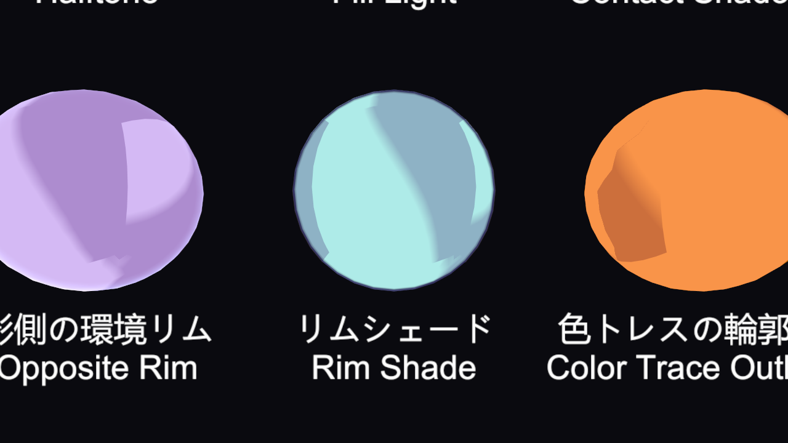
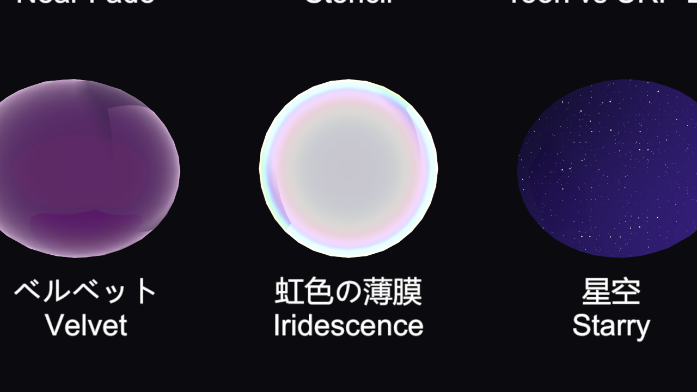
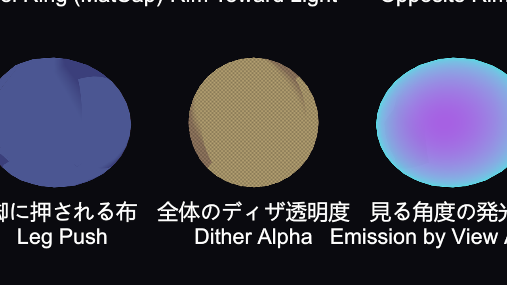
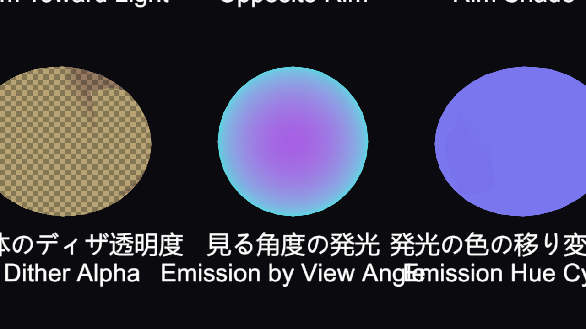
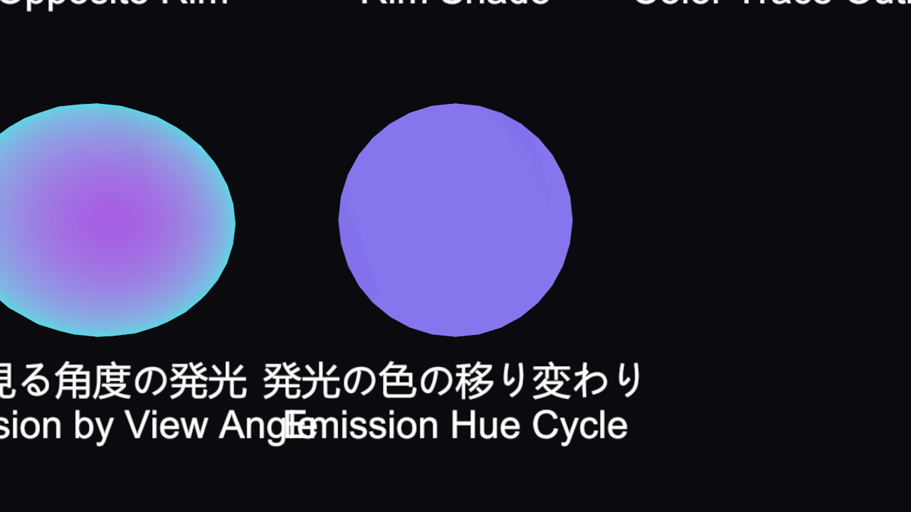
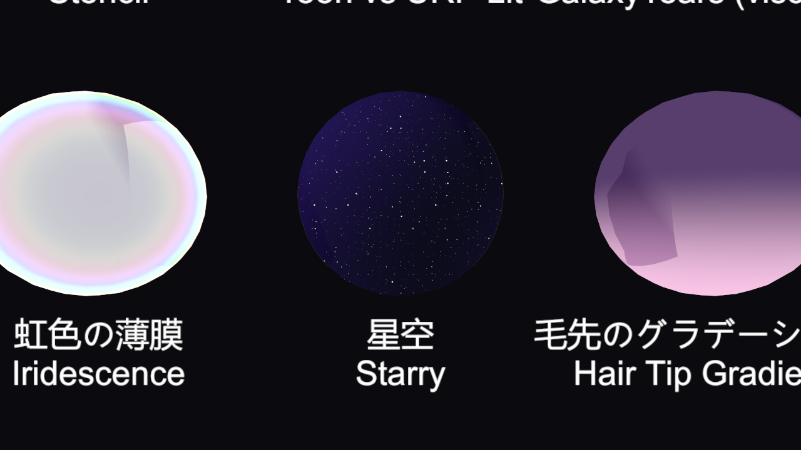

# シェーダー: トゥーンの強化

[ドキュメント目次](README.md)

Inspector の見出し **トゥーンの強化 (光・影・リム・マットキャップ・遠近)** の説明です(1.0.2 で追加)。どの項目も既定は「効かない」値になっていて、変えたものだけが効きます。

- [光](#光)
- [影](#影)
- [リム・マットキャップ・虹色](#リムマットキャップ虹色)
- [深度と遠近](#深度と遠近)
- [髪・ハイライト・発光](#髪ハイライト発光)
- [頂点カラー](#頂点カラー)
- [輪郭線](#輪郭線)
- [接地影・体の自己影](#接地影体の自己影)
- [星空](#星空)
- [鼻線](#鼻線)
- [パック型マスク](#パック型マスク)
- [音・Volume](#音volume)

---

## 光

| 項目 | 説明 |
|---|---|
| 光の色の正規化 | ライトの色のいちばん明るいチャンネルを 1 にそろえ、色味だけ残します。暗い色のライトでも塗りが暗くなりません |
| 明るさの上限をなめらかに | 1 を超えた明るさを、急に頭打ちにせず、少しずつ抑えます |
| 環境光を頭の向きで前と後ろに分ける | 環境光(SH)を頭の前と後ろの 2 方向だけで読み、首を振っても陰影の向きが落ち着きます。頭の向きは **Galaxy Toon Face** が入れます |
| 追加ライトは距離だけで明るく | ポイントライト・スポットライトを、面の向きを見ずに距離だけで明るくします |
| 追加ライトの境界 | 追加ライトの当たる/当たらないの境界。負の値なら「影1の境界」と同じです |
| 追加ライトの明るさの上限 / 追加ライトの色を灰色に | 追加ライトの明るさの頭打ちと、色の白黒化 |

## 影

| 項目 | 説明 |
|---|---|
| 影の側を空の色に寄せる | 環境光(SH)の色味を、影の所だけに掛けます。夕焼け・青空のときに影が空の色になります |
| 落ち影を受ける位置のずらし | 落ち影を読む位置を、光の向きへ少しずらします(cm)。顔・体に出る自己影の汚れを減らします |
| 昼／夜のランプ | 影のランプの上半分を昼、下半分を夜として、**夜のランプの量** で混ぜます。グローバル値 `_GalaxyNight`(**Galaxy Toon Light** の「夜の量」)も足されます |

## リム・マットキャップ・虹色

| 項目 | 説明 |
|---|---|
| リムシェード | 輪郭の内側を、掛け算で暗く・色味を変えて締めます(加算のリムとは別)。A が強さです |
| リムシェードの鋭さ・境界・ぼかし | リムシェードの形 |
| 深度リムのやわらかさ | 深度リムを 3 か所で読んで、境目をなめらかにします。0 で今までどおりです |
| マットキャップの歪みを補正 | 画面の端でもマットキャップがゆがまないようにします |
| マットキャップをカメラの傾きに合わせない | カメラを傾けても、マットキャップが一緒に回りません |
| マットキャップのマスク | R が白い所だけにマットキャップを出します |
| 虹色の薄膜の強さ・回る速さ・色相のずらし | 見る角度で色相が回る膜(シャボン玉・油膜・玉虫色) |

## 深度と遠近

| 項目 | 説明 |
|---|---|
| 深度だけ手前へ | 見た目の位置は変えず、深度だけを手前へずらします(cm)。眉・目のふちを髪の手前に出すときに使います |
| 深度のずらしのマスク | R が白い所だけをずらします |
| 遠近の除去 | 頭の中心の奥行きで画面に写し、広角で寄っても顔がゆがまないようにします。中心は **Galaxy Toon Face** が入れます(顔と髪がずれないよう、キャラの全部に同じ中心を入れます) |
| 全体のディザ透明度 | 1 で不透明。下げると、網目状に抜いて透かします。影・深度・輪郭線のパスも同じ抜き方なので、出入りの演出や遮蔽物の向こうのキャラに使えます |

## 髪・ハイライト・発光

| 項目 | 説明 |
|---|---|
| 髪のハイライトの形 | 天使の輪を、正面ほど丸く短く、縁ほど細長くします |
| ハイライトのチラつきを抑える | 画面上の変化が大きい所(遠い・細かい所)で、ハイライトの境界をぼかして点滅を抑えます |
| テクスチャの線を遠くでも残す | テクスチャに描いた線が、遠くでミップで薄れて消えないようにします |
| 発光の色の移り変わり | 発光の色相を、時間で回します(1 秒あたりの回転) |
| 発光の、見る角度で変わる色 | 縁ほど別の色の発光になります。A が強さです |

|  |  |
|---|---|
| 見る角度の発光 | 発光の色の移り変わり |

## 頂点カラー

メッシュの頂点カラーに、意味を持たせて使えます。

| 項目 | 頂点カラー | 説明 |
|---|---|---|
| 頂点カラー R で影を出やすく | R | R が黒いほど影になります |
| 頂点カラー G で影の境界をずらす | G | 灰(0.5)でそのまま。明るいほど影が出にくくなります |
| 頂点カラー B で輪郭線を奥へ | B | 輪郭線を奥へ押して、内側の線を隠します(cm) |
| 頂点カラー A で輪郭線の太さ | A | 輪郭線の太さに掛けます |

## 輪郭線

| 項目 | 説明 |
|---|---|
| 輪郭線を光の側で太く | 光が当たる側の輪郭線を太くします |
| 輪郭線が細くなりはじめる距離 / 消える距離 | 遠くのキャラの線がつぶれないよう、距離で細くして消します(m)。始まりが終わりより大きいと使いません |

## 接地影・体の自己影

| 項目 | 説明 |
|---|---|
| 接地影 | カメラの深度テクスチャを光の向きへたどり、指・襟などの接点に細い影を付けます(ON / OFF) |
| 接地影の濃さ・長さ | 影の濃さと、たどる長さ(cm) |
| 体の自己影の濃さ・長さ・厚み | 接地影と同じたどり方を長くして、顎の下や腕から胴への影を出します(接地影を ON にすると効きます) |

> カメラの深度テクスチャが必要です。URP Asset の **Depth Texture** を ON にしてください。

## 星空

| 項目 | 説明 |
|---|---|
| 星空 | 画面に貼りつく星と星雲の強さ。マスクの所だけに出ます |
| 星空のマスク | R が白い所だけに出します |
| 星の色 / 星雲の色 | 星の色と、星雲の色(A が強さ) |
| 星の細かさ / 星の奥行き | 星の数と、見る角度でずれる量(視差) |

## 鼻線

横顔になったときだけ、鼻筋に線を描きます。

| 項目 | 説明 |
|---|---|
| 鼻線のマスク | R が白い所に線を出します。顔テクスチャに合わせて描いてください |
| 鼻線の色 | 線の色。A が強さです(0 で出ません) |
| 鼻線が出はじめる横向きの量 | どれだけ横を向いたら線を出すか |

## パック型マスク

1 枚のテクスチャの RGBA に、いくつかのマスクをまとめて入れる方式です。

| 項目 | 説明 |
|---|---|
| パック型マスク | ON / OFF |
| パック型マスク(テクスチャ) | R=ハイライトの強さ、G=影のしきい値、B=ハイライトのマスク、A=素材 ID(0〜7) |
| パック型マスク G の効き | G で影の出やすさを変える強さ |
| 素材 ID ごとの色 | 横 4 マス(ハイライト・リム・輪郭線・光る色)× 縦 8 段(素材 ID)の色の表 |

## 音・Volume

| 項目 | 説明 |
|---|---|
| 音に合わせる帯域 | 低音・中音・高音・全体のどれに合わせるか |
| 音で発光を強める量 / リムを強める量 / 輪郭線を太くする量 | 音の大きさで変える量 |
| Volume の調整を受ける | Volume の「Galaxy Toon」の調整を受けるか。瞳など外したい所はオフにします |

音は **Galaxy Audio React**、Volume は **Galaxy Toon Volume Feature** が値を入れます。くわしくは [画面の効果・音・Volume](rendering.md) を見てください。
